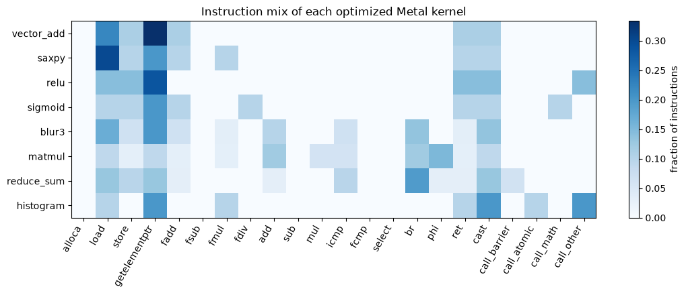
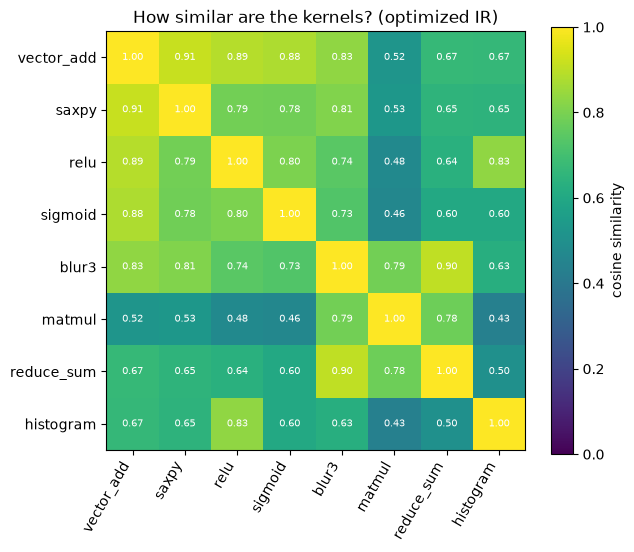
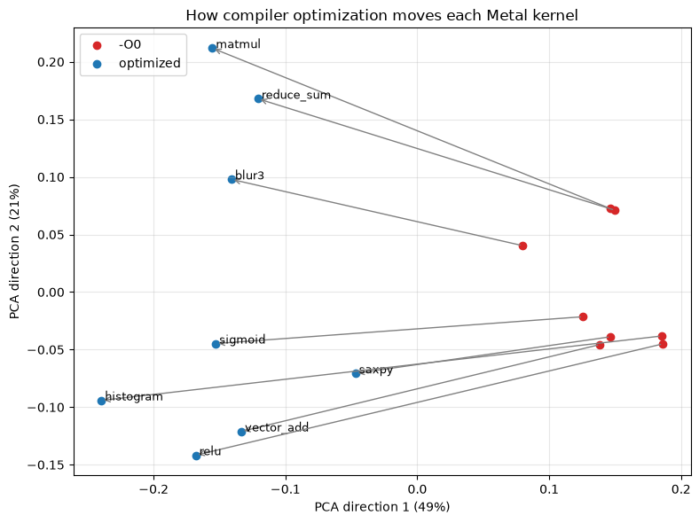

# Metal GPU kernels through the compiler's eyes

Representing Apple GPU kernels as vectors built from their compiler IR (AIR, Apple's LLVM-based IR), and measuring what compiler optimization changes.

## Question

If each GPU kernel is represented as a vector built from its IR, do similar kernels end up close together? And does optimization (`-O0` → optimized) change every kernel in a similar way?

## Method

- **Kernels:** 8 small Metal kernels covering different kinds of GPU work: elementwise (`vector_add`, `saxpy`, `relu`, `sigmoid`), stencil (`blur3`), loop (`matmul`), threadgroup reduction with barriers (`reduce_sum`) and atomics (`histogram`).
- **Compilation:** each kernel compiled to AIR at `-O0` and at the default optimization level with `xcrun -sdk macosx metal -S -emit-llvm`.
- **Representation:** normalized instruction counts per kernel (a "bag of instructions", a simplified version of the symbolic idea behind [IR2Vec](https://compilers.cse.iith.ac.in/research/ir2vec/index.html)). GPU-specific `@air.*` calls are split into barrier, atomic and math calls.
- **Analysis:** cosine similarity between kernels, PCA projection, and the `-O0` → optimized change vector for each kernel.

## Results

### Optimization shrinks every kernel by 45–74%

| Kernel | Instructions at `-O0` | Optimized | Reduction |
|---|---|---|---|
| vector_add | 25 | 9 | 64% |
| saxpy | 28 | 10 | 64% |
| relu | 24 | 7 | 71% |
| sigmoid | 24 | 10 | 58% |
| blur3 | 55 | 30 | 45% |
| matmul | 65 | 33 | 49% |
| reduce_sum | 78 | 31 | 60% |
| histogram | 38 | 10 | 74% |

Kernels with branches and loops (`blur3`, `matmul`) shrink least, because their control flow (`br`, `phi`, comparisons) is real work that stays after optimization.

### Instruction mix of each optimized kernel



### Which kernels look alike?



- The four elementwise kernels are highly similar to each other (cosine similarity 0.78–0.91).
- Kernels with control flow form a separate group: `blur3` and `reduce_sum` are the most similar pair outside the elementwise group (0.90), and `matmul` is closest to them (0.78–0.79) while being the least similar to the elementwise kernels (0.46–0.53).
- `histogram` does **not** stand apart: it is closest to `relu` (0.83). Its atomic operation is a single instruction, so it barely changes the instruction mix. Likewise, `reduce_sum`'s two barriers matter less to its vector than its branches and memory operations.

### How optimization moves each kernel



The two PCA directions explain 70% of the variation (49% + 21%). Direction 1 mostly separates `-O0` from optimized code; direction 2 separates straight-line elementwise kernels from kernels with control flow.

**Consistency of the optimization direction** (cosine similarity of each kernel's change vector with the average change):

| vector_add | saxpy | relu | sigmoid | blur3 | matmul | reduce_sum | histogram |
|---|---|---|---|---|---|---|---|
| 0.89 | 0.88 | 0.94 | 0.94 | 0.85 | 0.82 | 0.92 | 0.90 |

The average change is dominated by fewer `alloca` (−0.156), `load` (−0.155) and `store` (−0.112), the signature of **mem2reg** promoting stack variables to registers. `matmul` and `blur3` are the least consistent: their branch instructions stay after optimization, so removing memory traffic shifts their mix differently, and `matmul` also gains `phi` nodes (5) for its loop in SSA form.

## Finding

A simple instruction-count representation of AIR separates straight-line elementwise kernels from kernels with control flow, and compiler optimization moves all kernels in a largely consistent direction (0.82–0.94), dominated by mem2reg removing memory traffic. However, count-based vectors barely distinguish kernels by their rare but important GPU operations (barriers, atomics), which motivates richer, flow-aware representations.

## Limitations

- Counting instructions ignores order and data flow; different programs can share a vector.
- Only 8 kernels; static analysis with no runtime measurements.
- Apple's GPU backend after AIR is closed source, so only the frontend and middle-end are visible.


## Repository structure

```
├── metal_kernels_as_vectors.ipynb   # full pipeline: kernels → AIR → vectors → plots
├── kernels/                         # the 8 Metal kernels
├── ir/                              # generated AIR (.ll) at -O0 and optimized
├── figures/                         # plots used in this README
├── NOTES.md                         # my notes on the concepts behind the project
└── requirements.txt
```

## How to run

Requires macOS with Xcode installed (the Metal compiler is macOS-only).

```bash
pip install -r requirements.txt
jupyter notebook metal_kernels_as_vectors.ipynb   # then Run All
```

---

Built with AI assistance as a learning aid; experiments run and analysed by me.
